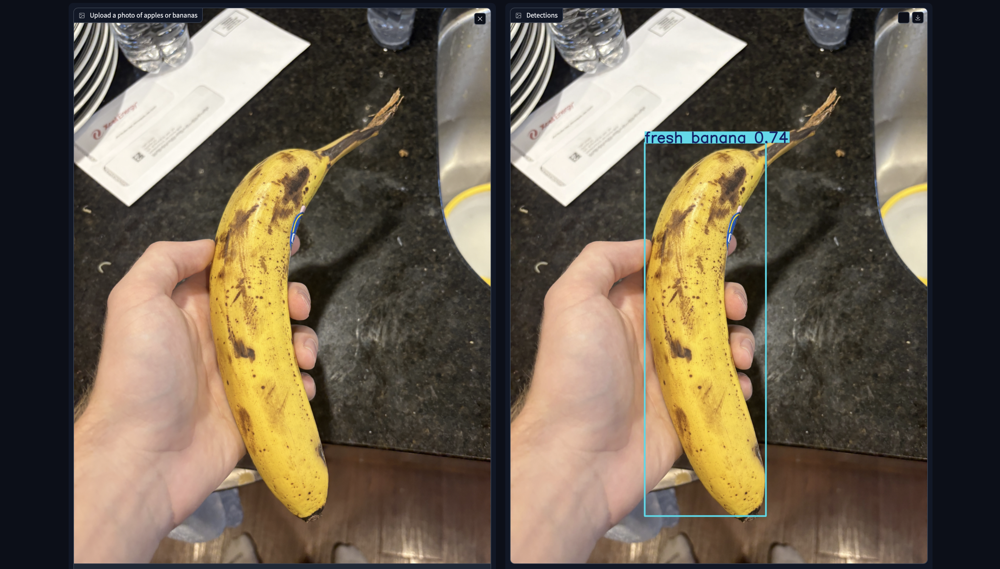
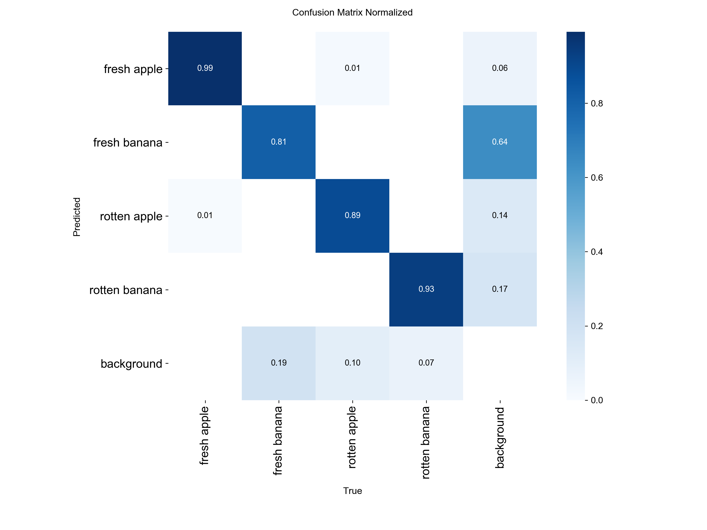
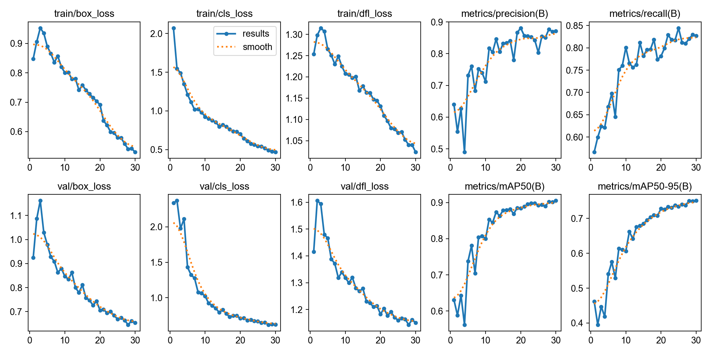

# Fruit Freshness Inspector

A computer vision system that detects apples and bananas in images and classifies each one as fresh or rotten, built with YOLOv8 and deployed as an interactive web demo.

## Results

Evaluated on a held-out test set of 246 images (458 labeled fruit) that the model never saw during training.

| Metric | Score |
|---|---|
| mAP@50 | 0.946 |
| mAP@50-95 | 0.787 |
| Precision | 0.872 |
| Recall | 0.904 |

| Class | Precision | Recall | mAP@50 |
|---|---|---|---|
| Fresh apple | 0.954 | 0.984 | 0.987 |
| Fresh banana | 0.822 | 0.831 | 0.900 |
| Rotten apple | 0.864 | 0.955 | 0.974 |
| Rotten banana | 0.848 | 0.847 | 0.922 |

Inference runs at about 5 ms per image on an Apple M4 laptop.

## Analysis

**Fresh bananas are the weakest class.** Recall was 0.61 on the validation set and 0.83 on the test set. The gap between the two suggests the small test set (128 fresh bananas) makes this estimate noisy, but fresh bananas trail every other class in both. Likely causes include visual overlap with lightly spotted bananas and less variety in the training images.

**Data quality issues were handled during training.** The source dataset mixed polygon (segmentation) and bounding-box labels. YOLOv8 converted all labels to boxes, and one corrupt image was excluded automatically.

**Real-world generalization is limited.** Most training images are close-ups on plain backgrounds, so performance drops on cluttered kitchen photos. Borderline cases, such as yellow bananas with heavy spotting, are also ambiguous by nature.

## Future Improvements

- Collect more fresh banana and borderline-ripeness images, especially on cluttered backgrounds
- Train a larger model (YOLOv8s or YOLOv8m) and for more epochs
- Add a ripeness scale (unripe, ripe, overripe, rotten) instead of a binary fresh/rotten label

## How It Works

1. **Dataset:** 2,539 labeled images from Roboflow Universe, split 71/19/10 into train, validation, and test sets
2. **Model:** YOLOv8n (3M parameters), fine-tuned from COCO-pretrained weights for 30 epochs at 640x640 on an Apple M4 GPU (MPS)
3. **Demo:** A Gradio web app that draws detections and returns a PASS/REJECT inspection verdict, rejecting any batch containing rotten fruit

## Run It Yourself

    git clone https://github.com/YOUR_USERNAME/fruit-freshness-inspector.git
    cd fruit-freshness-inspector
    python3 -m venv venv
    source venv/bin/activate
    pip install -r requirements.txt
    python app.py

Then open http://127.0.0.1:7860 in your browser.

## Tech Stack

Python, PyTorch, Ultralytics YOLOv8, Gradio, Roboflow

## Dataset

"fruit_dataset" (version 3) by EEE357project on Roboflow Universe, licensed under CC BY 4.0: https://universe.roboflow.com/eee357project/fruit_dataset-6o0al
